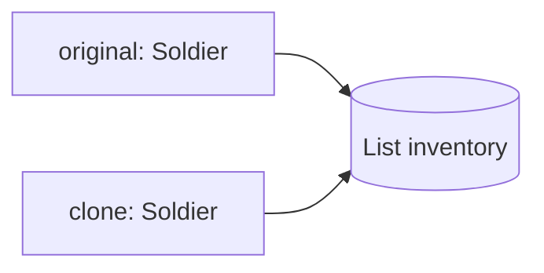

# Шаблони проєктування GoF
### Вступ · Породжувальні шаблони, частина 1

---

## План

1. Що таке шаблони проєктування і звідки вони взялись <!-- element class="fragment" -->
2. Класифікація GoF <!-- element class="fragment" -->
3. Singleton: особливості реалізації в Java та проблеми тестування <!-- element class="fragment" -->
4. Prototype <!-- element class="fragment" -->
5. Object Pool <!-- element class="fragment" -->

---

# Частина 1
## Шаблони проєктування

---

## SOLID → GRASP → GoF

| Рівень | Що дає | Питання |
|---|---|---|
| **SOLID** | стратегічні критерії якості | **яким** має бути дизайн? |
| **GRASP** | евристики розподілу обов'язків | **кому** доручити відповідальність? |
| **GoF** | конкретні мікроархітектурні рішення | **як саме** побудувати класи і зв'язки? |

<!-- element class="fragment" -->
Приклад: GRASP **Polymorphism** каже "замість `switch` — поліморфізм". GoF **Strategy** дає точну структуру інтерфейсів і класів для цього.

---

## Що таке шаблон проєктування?

![[gof_meme_design_pattern.png]] <!-- element style="height:520px" -->

---

## Що таке шаблон проєктування?

![[gof_pattern_definition.png]] <!-- element style="width:85%" -->

![[gof_pattern_definition_uk.png]] <!-- element style="width:60%" -->

---

## Звідки взялись шаблони?

![[gof_book_alexander.png]] <!-- element style="height:420px" -->
![[gof_book_gof.png]] <!-- element style="height:420px" -->

---

## Історія

- **1977** — Крістофер Александер, "A Pattern Language": шаблони в архітектурі будівель — висота вікон, кількість поверхів, площа під газони <!-- element class="fragment" -->
- **1994** — Гамма, Хелм, Джонсон, Вліссідес: "Design Patterns: Elements of Reusable Object-Oriented Software" — **23 шаблони** <!-- element class="fragment" -->
- Авторів прозвали **Gang of Four**, книгу — **GoF book** <!-- element class="fragment" -->
- Приклади в книзі — на C++ і Smalltalk; Java вийшла через рік і стала мовою, де шаблони використовують найактивніше <!-- element class="fragment" -->

---

## Чотири елементи шаблону

| Елемент | Зміст |
|---|---|
| **Назва** | словник: одне слово замість абзацу пояснень |
| **Проблема** | коли застосовувати, контекст |
| **Рішення** | ролі класів, зв'язки, обов'язки — не готовий код |
| **Наслідки** | переваги, недоліки, компроміси |

<!-- element class="fragment" -->
Шаблон — це **креслення**, а не бібліотека: його реалізують під конкретну задачу.

---

## Навіщо програмісту знати шаблони?

![[gof_meme_no_idea.png]] <!-- element style="height:300px" -->

- **Перевірені рішення** — не винаходити велосипед <!-- element class="fragment" -->
- **Стандартизація коду** — приховані проблеми рішення вже відомі <!-- element class="fragment" -->
- **Спільний словник** — "тут Decorator" замість години пояснень <!-- element class="fragment" -->
- **Читання фреймворків** — JDK, Spring, Hibernate побудовані на шаблонах <!-- element class="fragment" -->

---

## Коли шаблони шкодять

- **Pattern fever**: шаблон заради шаблону <!-- element class="fragment" -->
- `AbstractSingletonProxyFactoryBean` — клас, що реально існує в Spring <!-- element class="fragment" -->
- порушення **KISS** і **YAGNI**: гнучкість, яка ніколи не знадобиться <!-- element class="fragment" -->

<!-- element class="fragment" -->
Шаблон вводять, коли **проблема вже є** або точно з'явиться, а не "про всяк випадок".

---

## Як ми розбиратимемо кожен шаблон

1. **Проблема** — конкретна ситуація і чому прямолінійне рішення погане <!-- element class="fragment" -->
2. **Рішення** — ідея шаблону <!-- element class="fragment" -->
3. **Структура** — ролі класів <!-- element class="fragment" -->
4. **У Java** — як це виглядає в JDK і фреймворках, особливості мови <!-- element class="fragment" -->
5. **Код** — наживо <!-- element class="fragment" -->
6. **Переваги і недоліки** <!-- element class="fragment" -->

---

## Класифікація GoF

| Породжувальні | Структурні | Поведінкові |
|---|---|---|
| Singleton | Adapter | Chain of Responsibility |
| Prototype | Decorator | Command |
| *Object Pool* | Facade | Observer |
| Builder | Proxy | Mediator |
| Factory Method | Bridge | Strategy, State |
| Abstract Factory | Composite | Template Method |
| | Flyweight | Memento, Visitor, Iterator |

- **Породжувальні** — гнучке створення об'єктів без зайвих залежностей <!-- element class="fragment" -->
- **Структурні** — способи побудови зв'язків між об'єктами <!-- element class="fragment" -->
- **Поведінкові** — ефективна комунікація між об'єктами <!-- element class="fragment" -->

---

## Наш маршрут

| Лекція | Тема |
|---|---|
| 16 | Вступ · Singleton, Prototype, Object Pool |
| 17 | Builder, Factory Method, Abstract Factory |
| 18 | Шаблони-обгортки: Adapter, Decorator, Facade, Proxy |
| 19 | Bridge, Composite, Flyweight |
| 20 | Chain of Responsibility, Command |
| 21 | Observer, Mediator |
| 22 | Strategy, State, Template Method |
| 23 | Memento, Visitor, Iterator |

---

# Частина 2
## Породжувальні шаблони

---

## Проблема оператора `new`

`new ConcreteClass()`, розкиданий по всьому коду:
- клієнт жорстко прив'язаний до конкретної реалізації (**High Coupling**) <!-- element class="fragment" -->
- складна ініціалізація дублюється <!-- element class="fragment" -->
- неможливо підмінити реалізацію в тестах <!-- element class="fragment" -->
- неможливо контролювати **кількість** і **життєвий цикл** об'єктів <!-- element class="fragment" -->

<!-- element class="fragment" -->
Породжувальні шаблони **абстрагують процес створення**: система не залежить від того, як її об'єкти створюються, компонуються та представляються.

---

# Singleton
## Одинак

![[gof_singleton_title.png]] <!-- element style="height:380px" -->

---

## Проблема: налаштування застосунку

Клас `AppConfig` читає `application.properties`: файл, парсинг, перевірка значень.

- `OrderService`, `PaymentService`, `MailService` кожен робить `new AppConfig()` <!-- element class="fragment" -->
- файл читається десятки разів <!-- element class="fragment" -->
- адміністратор вмикає feature flag під час роботи — бачить лише один об'єкт, решта працює зі старими значеннями <!-- element class="fragment" -->

<!-- element class="fragment" -->
Потрібно: **рівно один** об'єкт конфігурації і **зручний доступ** до нього з будь-якого місця.

---

## Наївні рішення

**Передавати конфіг у кожен конструктор?** <!-- element class="fragment" -->
- ніхто не заважає створити ще один екземпляр <!-- element class="fragment" -->

**`public static AppConfig CONFIG` у якомусь класі?** <!-- element class="fragment" -->
- будь-хто може перезаписати посилання <!-- element class="fragment" -->
- об'єкт створюється при завантаженні класу, навіть якщо не потрібен <!-- element class="fragment" -->
- клас `AppConfig` досі можна створити через `new` <!-- element class="fragment" -->

<!-- element class="fragment" -->
Потрібно, щоб **сам клас** гарантував єдиність свого екземпляра.

---

## Рішення: Singleton

Породжувальний шаблон, який гарантує, що клас має **лише один екземпляр**, і надає **глобальну точку доступу** до нього.

![[gof_singleton.png]] <!-- element style="height:380px" -->

<small>Ілюстрації взято з https://refactoring.guru/uk/design-patterns/</small>

---

## Як виглядає Singleton?

![[gof_singleton_uml.png]] <!-- element style="height:340px" -->

- `private static` поле — єдиний екземпляр <!-- element class="fragment" -->
- `private` конструктор — `new` поза класом неможливий <!-- element class="fragment" -->
- `public static getInstance()` — глобальна точка доступу, створює об'єкт при першому зверненні <!-- element class="fragment" -->

---

## Реалізації в Java

| Варіант | Ліниве створення | Потокобезпечний | Захист від reflection / серіалізації |
|---|---|---|---|
| `static final` поле (eager) | ні | так | ні |
| `synchronized getInstance()` | так | так, але повільно | ні |
| Double-Checked Locking + `volatile` | так | так | ні |
| **Holder idiom** | так | так | ні |
| **`enum`** | при першому зверненні | так | **так** |

<!-- element class="fragment" -->
Effective Java (Item 3): **enum з одним елементом** — найкращий спосіб реалізувати Singleton.

---

## Проблема багатопотоковості

Наївна перевірка `if (instance == null)`:

1. потоки A і B одночасно викликають `getInstance()` <!-- element class="fragment" -->
2. обидва бачать `instance == null` <!-- element class="fragment" -->
3. обидва створюють об'єкт <!-- element class="fragment" -->

<!-- element class="fragment" -->
**Race condition**: два екземпляри, частина системи працює з "чужим" конфігом.

<!-- element class="fragment" -->
`synchronized` на весь метод вирішує проблему, але кожен виклик бере блокування, хоча потрібне воно лише один раз.

---

## Double-Checked Locking і `volatile`

Перевірка → блокування → повторна перевірка всередині блокування.

`instance = new AppConfig()` — не атомарна операція: <!-- element class="fragment" -->
1. виділити пам'ять <!-- element class="fragment" -->
2. виконати конструктор <!-- element class="fragment" -->
3. записати посилання в поле <!-- element class="fragment" -->

<!-- element class="fragment" -->
JIT і процесор можуть переставити кроки 2 і 3. Без `volatile` інший потік побачить посилання на **недобудований об'єкт**. Java Memory Model гарантує коректність DCL лише з `volatile` (з Java 5).

---

## Holder idiom

**Initialization-on-demand holder**:
- екземпляр живе в `private static` вкладеному класі <!-- element class="fragment" -->
- JVM завантажує та ініціалізує вкладений клас лише при першому зверненні до нього <!-- element class="fragment" -->
- JVM гарантує, що ініціалізація класу виконується **рівно один раз** і потокобезпечно <!-- element class="fragment" -->

<!-- element class="fragment" -->
Результат: лінивість і потокобезпека без жодного `synchronized` і `volatile`.

---

## Знайти і знешкодити

![[gof_meme_singleton_find.png]] <!-- element style="height:460px" -->

---

## Як "зламати" Singleton

| Атака | Як | Захист |
|---|---|---|
| **Reflection** | `setAccessible(true)` на приватному конструкторі | перевірка в конструкторі або `enum` |
| **Серіалізація** | десеріалізація створює новий об'єкт | метод `readResolve()` або `enum` |
| **Кілька ClassLoader-ів** | кожен завантажує свою копію класу | — |
| **`clone()`** | якщо клас реалізує `Cloneable` | не реалізовувати |

<!-- element class="fragment" -->
`enum` захищений від reflection і серіалізації на рівні JVM. Обмеження: не може наслідувати інший клас.

---

## Singleton vs статичний утилітний клас

| | Singleton | Клас зі `static` методами |
|---|---|---|
| Реалізує інтерфейс | так | ні |
| Поліморфізм, підміна | можлива | неможлива |
| Ліниве створення | так | ні |
| Стан | так | лише статичний |
| Приклад | конфігурація, реєстр | `Math`, `Collections`, `Objects` |

<!-- element class="fragment" -->
Немає стану і не потрібна підміна — досить утилітного класу з приватним конструктором.

---

## Проблема: Singleton і тести

![[gof_meme_singleton_alone.png]] <!-- element style="height:400px" -->

---

## Прихована залежність

`OrderService.placeOrder()` всередині викликає `AppConfig.getInstance().getTaxRate()`.

- сигнатура `OrderService` бреше: залежність від конфігу ніде не видно <!-- element class="fragment" -->
- щоб зрозуміти, що потрібно класу, треба прочитати весь його код <!-- element class="fragment" -->
- залежність від **конкретного класу**, а не абстракції — порушення **DIP** <!-- element class="fragment" -->

<!-- element class="fragment" -->
Тест хоче перевірити ставку податку 0% — але не може підставити свій конфіг.

---

## Протікання стану між тестами

- `testA` вмикає feature flag в єдиному екземплярі <!-- element class="fragment" -->
- `testB` очікує вимкнений флаг — падає, але лише якщо запущений **після** `testA` <!-- element class="fragment" -->
- окремо кожен тест зелений, разом — червоні <!-- element class="fragment" -->
- паралельний запуск тестів (JUnit 5 parallel execution) — непередбачувані результати <!-- element class="fragment" -->

<!-- element class="fragment" -->
**Flaky tests**: результат залежить від порядку запуску. Команда перестає довіряти тестам.

---

## Милиці для тестування Singleton

- метод `resetForTests()` — тестовий код у продакшн-класі <!-- element class="fragment" -->
- зміна приватного поля через reflection <!-- element class="fragment" -->
- `Mockito.mockStatic()` (з Mockito 3.4) — працює, але вимагає `try-with-resources` в кожному тесті і лише маскує проблему дизайну <!-- element class="fragment" -->

<!-- element class="fragment" -->
Якщо для тесту потрібна "магія" — проблема в дизайні, а не в тестах.

---

## Best practice: Dependency Injection

Рефакторинг Singleton:
1. виділити інтерфейс `Config` <!-- element class="fragment" -->
2. зробити конструктор `AppConfig` звичайним <!-- element class="fragment" -->
3. передавати `Config` у залежні класи **через конструктор** <!-- element class="fragment" -->
4. єдиність екземпляра доручити **контейнеру** <!-- element class="fragment" -->

<!-- element class="fragment" -->
**Spring**: scope `singleton` — за замовчуванням для кожного `@Component` / `@Bean`. Один екземпляр **на ApplicationContext**, у тестах — свій об'єкт або mock.

<!-- element class="fragment" -->
Один екземпляр — рішення **конфігурації**, а не структури класу.

---

## Коли ручний Singleton доречний

- немає DI-контейнера: бібліотека, утиліта командного рядка, Android без DI <!-- element class="fragment" -->
- об'єкт без змінюваного стану: кеш незмінних даних, реєстр <!-- element class="fragment" -->
- JDK: `Runtime.getRuntime()`, `Desktop.getDesktop()` <!-- element class="fragment" -->

<!-- element class="fragment" -->
"У системі одна БД — отже, підключення має бути Singleton" — підміна понять: кількість ресурсів в інфраструктурі не повинна диктувати структуру коду.

---

## ENOUGH THEORY

![[gof_enough_theory.png]] <!-- element style="height:460px" -->

---

## Переваги і недоліки Singleton

| Переваги | Недоліки |
|---|---|
| гарантує єдиний екземпляр | глобальний стан, прихована залежність |
| глобальна точка доступу | складно тестувати |
| відкладена ініціалізація | потребує уваги в багатопотоковому середовищі |
| | порушує SRP: клас керує і логікою, і своїм життєвим циклом |

---

# Prototype
## Прототип

![[gof_prototype_title.png]] <!-- element style="height:300px" -->

---

## Проблема: армія ворогів

Гра: на рівні 1000 солдатів.

- створення солдата: завантажити 3D-модель і текстури з диска, налаштувати AI, розрахувати характеристики <!-- element class="fragment" -->
- 1000 разів `new Soldier(...)` — рівень завантажується хвилину <!-- element class="fragment" -->
- солдати майже однакові: різниться лише позиція <!-- element class="fragment" -->

<!-- element class="fragment" -->
Ідея: створити **одного**, налаштувати і **копіювати**.

---

## Чому копіювати "ззовні" не вийде

Скопіювати поле за полем іншим класом?

- **приватні поля** недоступні <!-- element class="fragment" -->
- код копіювання знає **конкретний клас** — а маємо лише інтерфейс `Enemy` (солдат, лучник, маг?) <!-- element class="fragment" -->
- додали нове поле — забули оновити копіювання в п'яти місцях <!-- element class="fragment" -->

![[gof_meme_prototype.png]] <!-- element style="height:260px" class="fragment" -->

---

## Рішення: Prototype

Породжувальний шаблон, що дає змогу **копіювати об'єкти**, не вдаючись у подробиці їхньої реалізації. Об'єкт **сам** вміє створити свою копію.

![[gof_prototype.png]] <!-- element style="height:380px" -->

<small>Ілюстрації взято з https://refactoring.guru/uk/design-patterns/</small>

---

## Як виглядає Prototype?

![[gof_prototype_uml.png]] <!-- element style="height:460px" -->

- клієнт знає лише інтерфейс з методом `clone()` <!-- element class="fragment" -->
- копіювання стану — в **конструкторі копіювання**; підклас викликає `super(prototype)`, потім копіює свої поля <!-- element class="fragment" -->

---

## Реєстр прототипів

Де зберігати еталони "лучник", "маг", "елітний солдат"?

![[gof_prototype_registry.png]] <!-- element style="height:380px" -->

- централізоване сховище (`Map<String, Enemy>`), еталони реєструються на старті <!-- element class="fragment" -->
- реєстр завжди повертає **копію**, а не оригінал <!-- element class="fragment" -->

---

## Проблема: поверхнева копія

Солдат має список предметів в інвентарі. Скопіювали поля — і:

- клон підібрав аптечку — вона з'явилась і в оригінала <!-- element class="fragment" -->
- і в усіх 1000 клонів, створених з цього прототипу <!-- element class="fragment" -->

---

## Shallow vs Deep copy

| | Shallow copy | Deep copy |
|---|---|---|
| Примітиви | копіюються | копіюються |
| Посилання | копіюється **посилання** — об'єкт спільний | копіюється **вміст** — новий об'єкт |
| Вартість | дешево | дорожче |
| Ризик | зміна клона змінює оригінал | — |

<!-- element class="fragment" -->
Незмінні об'єкти (`String`, `LocalDate`, `record` з незмінних полів) можна безпечно ділити — їх копіювати не потрібно. Текстуру на 50 МБ теж ділять навмисно.

---

## Java: проблема `Cloneable`

`Cloneable` + `Object.clone()` — вбудований, але **зламаний** механізм (Effective Java, Item 13):

- `Cloneable` — маркерний інтерфейс **без методу** `clone()` <!-- element class="fragment" -->
- `Object.clone()` — `protected`, кидає checked `CloneNotSupportedException` <!-- element class="fragment" -->
- копія **поверхнева**, створюється в обхід конструкторів — валідація не виконується <!-- element class="fragment" -->
- несумісний з `final` полями, які треба глибоко копіювати <!-- element class="fragment" -->
- повертає `Object` — потрібне приведення типу <!-- element class="fragment" -->

<!-- element class="fragment" -->
Виняток: масиви — `array.clone()` коректний і зручний.

---

## Java: best practices

- **конструктор копіювання** або статичний метод `copyOf()` / `from()` <!-- element class="fragment" -->
- власний типізований інтерфейс, напр. `Copyable<T>` з методом `T copy()` <!-- element class="fragment" -->
- колекції копіюємо явно: `new ArrayList<>(other)`, `List.copyOf()` <!-- element class="fragment" -->
- **незмінні об'єкти** — найкращий прототип: копіювати не треба, змінений стан — новий об'єкт (`withPosition(...)`) <!-- element class="fragment" -->
- глибока копія через серіалізацію (Jackson) — гарантований розрив графа, але повільно <!-- element class="fragment" -->

---

## Типові помилки

- **"брудні" клони**: `super.clone()` без копіювання колекцій — клон і оригінал ділять один `List` <!-- element class="fragment" -->
- реєстр повертає **оригінал** замість копії — хтось змінив еталон для всіх <!-- element class="fragment" -->
- додали поле — забули скопіювати в конструкторі копіювання. Захист — тест, що порівнює оригінал і копію <!-- element class="fragment" -->
- циклічні посилання при глибокому копіюванні → нескінченна рекурсія <!-- element class="fragment" -->

---

## ENOUGH THEORY

![[gof_enough_theory.png]] <!-- element style="height:460px" -->

---

## Переваги і недоліки Prototype

| Переваги | Недоліки |
|---|---|
| клонування без прив'язки до конкретних класів | складно клонувати об'єкти з циклічними посиланнями |
| менше повторюваного коду ініціалізації | треба стежити за глибиною копії |
| прискорює створення складних об'єктів | |
| альтернатива підкласам для варіантів конфігурації | |

---

# Object Pool
## Пул об'єктів

![[gof_object_pool.png]] <!-- element style="height:340px" -->

---

## Проблема: з'єднання з базою даних

Вебсервіс на кожен HTTP-запит відкриває нове з'єднання з PostgreSQL.

- TCP-рукостискання + TLS + автентифікація — десятки мілісекунд на **кожен** запит <!-- element class="fragment" -->
- під навантаженням 500 запитів/с — 500 нових з'єднань щосекунди <!-- element class="fragment" -->
- PostgreSQL за замовчуванням дозволяє **100** з'єднань → `too many connections` <!-- element class="fragment" -->

<!-- element class="fragment" -->
Створення дороге, кількість обмежена — а з'єднання ще й однакові.

---

## Наївне рішення: одне з'єднання на всіх

Зробити з'єднання Singleton?

- `Connection` не потокобезпечне — запити різних користувачів змішаються <!-- element class="fragment" -->
- усі запити стоять в черзі до одного з'єднання <!-- element class="fragment" -->
- з'єднання обірвалось — лягає весь сервіс <!-- element class="fragment" -->

<!-- element class="fragment" -->
Потрібно: **кілька** готових з'єднань, які **перевикористовуються**.

---

## Рішення: Object Pool

Набір **ініціалізованих і готових до використання** об'єктів. Об'єкт не створюється, а береться з пулу; після використання не знищується, а повертається.

- не входить до книги GoF <!-- element class="fragment" -->
- незамінний для **дорогих ресурсів** <!-- element class="fragment" -->

---

## Як виглядає Object Pool?

![[gof_object_pool_uml.png]] <!-- element style="height:300px" -->

1. об'єкти створюються один раз і зберігаються в пулі <!-- element class="fragment" -->
2. клієнт **позичає** (`acquire` / `borrow`) <!-- element class="fragment" -->
3. після роботи **повертає** (`release` / `return`) зі скиданням стану <!-- element class="fragment" -->
4. пул порожній: створити новий (до ліміту), чекати або кинути виняток <!-- element class="fragment" -->

---

## Java: коли пул НЕ потрібен

Виділення пам'яті в JVM дуже дешеве: зсув вказівника в **TLAB** (Thread-Local Allocation Buffer).

- короткоживучі об'єкти гинуть у **Young Generation** майже безкоштовно <!-- element class="fragment" -->
- об'єкти в пулі живуть довго → переходять в **Old Generation** → дорожчий GC <!-- element class="fragment" -->
- сучасні G1 / ZGC оптимізовані саме під багато дрібних короткоживучих об'єктів <!-- element class="fragment" -->

<!-- element class="fragment" -->
Пул звичайних об'єктів (DTO, точок, рядків) у Java — **антиоптимізація**.

---

## Java: коли пул потрібен

Пулять **ресурси**, а не пам'ять:

| Ресурс | Чому дорого | Рішення |
|---|---|---|
| з'єднання з БД | TCP + автентифікація | **HikariCP** |
| потоки ОС | системний виклик, стек ~1 МБ | `ExecutorService`, `ThreadPoolExecutor` |
| direct-буфери | пам'ять поза heap | Netty `PooledByteBufAllocator` |
| великі масиви | G1 *humongous objects* | пул буферів |

<!-- element class="fragment" -->
Віртуальні потоки (Java 21) **не пулять**: вони дешеві. Обмеження паралелізму — через `Semaphore`.

---

## Готові рішення

**Apache Commons Pool 2** — `GenericObjectPool<T>` + `PooledObjectFactory<T>`:

| Метод | Етап |
|---|---|
| `makeObject()` | створення |
| `validateObject()` | перевірка перед видачею |
| `passivateObject()` | скидання стану при поверненні |
| `destroyObject()` | знищення "зіпсованого" об'єкта |

<!-- element class="fragment" -->
**HikariCP**: `connection.close()` не закриває з'єднання, а **повертає в пул** — клієнт отримує proxy. З `try-with-resources` забути повернути неможливо.

---

## Розмір пулу

Більший пул ≠ швидший застосунок:
- ядер процесора та дисків у БД обмежена кількість <!-- element class="fragment" -->
- сотні з'єднань конкурують за ті самі ресурси — перемикання контексту, блокування <!-- element class="fragment" -->

<!-- element class="fragment" -->
Орієнтир з документації HikariCP: **з'єднань = ядра × 2 + кількість дисків**. Для 4-ядерного сервера БД — близько 10.

---

## Типові помилки

- **немає скидання стану** — наступний клієнт отримує "брудні" дані, витік конфіденційної інформації <!-- element class="fragment" -->
- **повторне повернення** (double release) — один об'єкт у двох клієнтів, race condition <!-- element class="fragment" -->
- **забули повернути** — пул вичерпується, потоки зависають. Рішення: `try-with-resources` / `finally` <!-- element class="fragment" -->
- **`finalize()` для очищення** — deprecated з Java 9; використовуйте `AutoCloseable` і `Cleaner` <!-- element class="fragment" -->

---

## ENOUGH THEORY

![[gof_enough_theory.png]] <!-- element style="height:460px" -->

---

## Переваги і недоліки Object Pool

| Переваги | Недоліки |
|---|---|
| перевикористання дорогих ресурсів | контроль за поверненням і скиданням стану |
| обмеження кількості ресурсів | синхронізація в багатопотоковому середовищі |
| передбачувана затримка | у Java шкодить, якщо пулити дешеві об'єкти |

---

## Порівняння

| Шаблон | Проблема | Ключова ідея |
|---|---|---|
| Singleton | потрібен рівно один об'єкт | клас сам контролює єдиність (краще — DI) |
| Prototype | створення з нуля дороге | копіювання готового еталона |
| Object Pool | дорогі ресурси обмеженої кількості | перевикористання замість створення |

---

## Висновки

- GoF — 23 перевірені рішення типових задач ООП і спільний словник розробників <!-- element class="fragment" -->
- **Singleton**: в Java — `enum` або Holder idiom; у реальних проєктах — scope контейнера, бо ручний Singleton ламає тести <!-- element class="fragment" -->
- **Prototype**: конструктор копіювання замість `Cloneable`; розрізняти shallow і deep copy <!-- element class="fragment" -->
- **Object Pool**: лише для дорогих ресурсів — з'єднання, потоки, буфери; дрібні об'єкти JVM створює дешевше <!-- element class="fragment" -->

---

# Питання?

![[gof_meme_thanks.png]] <!-- element style="height:400px" -->
