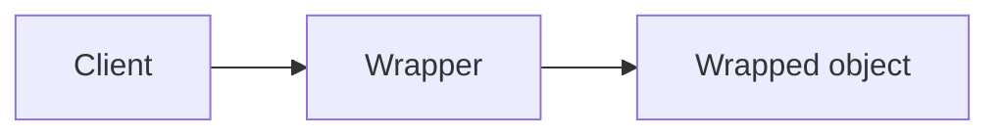

# Шаблони проєктування GoF
### Структурні шаблони, частина 1: шаблони-обгортки

---

## План

1. Що таке структурні шаблони і шаблони-обгортки <!-- element class="fragment" -->
2. Adapter <!-- element class="fragment" -->
3. Decorator <!-- element class="fragment" -->
4. Facade <!-- element class="fragment" -->
5. Proxy <!-- element class="fragment" -->
6. Порівняння обгорток <!-- element class="fragment" -->

---

## Структурні шаблони

Породжувальні відповідали на питання **як створити** об'єкт.

Структурні — **як поєднати** класи та об'єкти у більші структури, зберігаючи їх гнучкими: <!-- element class="fragment" -->
- композиція замість наслідування <!-- element class="fragment" -->
- робота з чужим кодом, який не можна змінити <!-- element class="fragment" -->
- приховування складності <!-- element class="fragment" -->

---

## Шаблони-обгортки

Спільна ідея: об'єкт **загортає** інший об'єкт і перехоплює звернення до нього.

| Шаблон | Інтерфейс обгортки | Навіщо |
|---|---|---|
| Adapter | **інший**, ніж у загорнутого | зробити сумісним |
| Decorator | **той самий** | додати поведінку |
| Facade | **новий, простіший** | спростити підсистему |
| Proxy | **той самий** | контролювати доступ |

---

# Adapter
## Адаптер

![[gof_meme_adapter.png]] <!-- element style="height:360px" -->

---

## Проблема: новий платіжний провайдер

Інтернет-магазин працює з інтерфейсом `PaymentProcessor`: метод `pay(Order order)`.

- бізнес підключає новий провайдер, його SDK має клас `StripeClient` з методом `charge(long cents, String currency, String token)` <!-- element class="fragment" -->
- SDK — чужа бібліотека, змінити її не можна <!-- element class="fragment" -->
- переписати весь магазин під API провайдера? А якщо завтра провайдер зміниться? <!-- element class="fragment" -->

<!-- element class="fragment" -->
Потрібні дані й поведінка вже є — інтерфейс не той.

---

## Рішення: Adapter

Структурний шаблон, що дає змогу об'єктам із **несумісними інтерфейсами** працювати разом.

![[gof_adapter.png]] <!-- element style="height:380px" -->

<small>Ілюстрації взято з https://refactoring.guru/uk/design-patterns/</small>

---

## Як це вирішує проблему

- `StripePaymentAdapter implements PaymentProcessor` <!-- element class="fragment" -->
- всередині — посилання на `StripeClient` <!-- element class="fragment" -->
- `pay(order)` перетворює дані: гривні → копійки, `Order` → токен, і викликає `charge(...)` <!-- element class="fragment" -->
- магазин не знає про Stripe; новий провайдер — новий адаптер <!-- element class="fragment" -->

![[gof_meme_adapter_socket.png]] <!-- element style="height:240px" class="fragment" -->

---

## Як виглядає Adapter?

![[gof_adapter_uml.png]] <!-- element style="height:400px" -->

- **об'єктний адаптер** (композиція) — основний варіант у Java <!-- element class="fragment" -->
- **класовий адаптер** (`extends Service implements ClientInterface`) — лише якщо адаптований клас не `final` <!-- element class="fragment" -->

---

## Adapter у Java

- `Arrays.asList()` — масив як `List` <!-- element class="fragment" -->
- `InputStreamReader` / `OutputStreamWriter` — байтовий потік як символьний <!-- element class="fragment" -->
- `Collections.enumeration()` / `Collections.list()` — `Collection` ↔ старий `Enumeration` <!-- element class="fragment" -->
- Spring MVC `HandlerAdapter` — різні типи обробників під один виклик <!-- element class="fragment" -->
- **Hexagonal Architecture** (Ports & Adapters): домен визначає порти-інтерфейси, адаптери підключають БД, REST, черги <!-- element class="fragment" -->

---

## Типові помилки

- бізнес-логіка всередині адаптера — він має лише **перетворювати** <!-- element class="fragment" -->
- "протікання" типів SDK назовні: адаптер повертає `StripeException` або `StripeCharge` <!-- element class="fragment" -->
- ланцюжок адаптерів A → B → C — сигнал, що інтерфейси треба переглянути <!-- element class="fragment" -->

---

## ENOUGH THEORY

![[gof_enough_theory.png]] <!-- element style="height:460px" -->

---

## Переваги і недоліки Adapter

| Переваги | Недоліки |
|---|---|
| приховує від клієнта деталі перетворення інтерфейсів | додаткові класи |
| дозволяє використати код, який не можна змінити | ланцюжки адаптерів ускладнюють відлагодження |
| реалізує SRP та OCP | |

---

# Decorator
## Декоратор

![[gof_meme_decorator.jpg]] <!-- element style="height:420px" -->

---

## Проблема: сповіщення

Бібліотека сповіщень: клас `Notifier` надсилає email.

- користувачі хочуть ще SMS, Telegram, Slack <!-- element class="fragment" -->
- підкласи `SmsNotifier`, `TelegramNotifier`… <!-- element class="fragment" -->
- а якщо одночасно SMS + Telegram? `SmsTelegramNotifier`, `SmsSlackNotifier`, `SmsTelegramSlackNotifier`… <!-- element class="fragment" -->
- 4 канали — до 15 підкласів; комбінацію треба обирати під час виконання, з налаштувань користувача <!-- element class="fragment" -->

---

## Чому наслідування не підходить

- наслідування **статичне**: поведінку не змінити під час виконання <!-- element class="fragment" -->
- у Java клас має лише **одного** батька <!-- element class="fragment" -->
- кількість комбінацій росте експоненційно <!-- element class="fragment" -->

<!-- element class="fragment" -->
Рішення: **композиція**. Об'єкт посилається на інший об'єкт і делегує йому роботу, додаючи щось своє.

---

## Рішення: Decorator

Структурний шаблон, що дає змогу **динамічно додавати** об'єктам нову функціональність, загортаючи їх у корисні "обгортки".

![[gof_decorator.png]] <!-- element style="height:380px" -->

<small>Ілюстрації взято з https://refactoring.guru/uk/design-patterns/</small>

---

## Як виглядає Decorator?

![[gof_decorator_uml.png]] <!-- element style="height:460px" -->

---

## Як це працює

- декоратор реалізує **той самий інтерфейс**, що й загорнутий об'єкт <!-- element class="fragment" -->
- викликає загорнутий об'єкт і додає поведінку **до** або **після** <!-- element class="fragment" -->
- клієнт не бачить різниці між декорованим і звичайним об'єктом <!-- element class="fragment" -->
- обгортки вкладаються одна в одну, як матрьошки <!-- element class="fragment" -->

<!-- element class="fragment" -->
`new SlackDecorator(new SmsDecorator(new EmailNotifier()))` — три канали без жодного комбінованого класу.

---

## Decorator у Java: `java.io`

Класичний приклад у JDK — потоки введення/виведення:

- `FileInputStream` — базовий компонент: читає байти з файлу <!-- element class="fragment" -->
- `BufferedInputStream` — додає буферизацію <!-- element class="fragment" -->
- `GZIPInputStream` — розпаковує <!-- element class="fragment" -->
- `CipherInputStream` — розшифровує <!-- element class="fragment" -->
- `DataInputStream` — читає примітиви <!-- element class="fragment" -->
- `FilterInputStream` — базовий клас усіх декораторів <!-- element class="fragment" -->

---

## Decorator у Java: інше

- `Collections.synchronizedList()`, `Collections.checkedList()` <!-- element class="fragment" -->
- Spring Security: `HttpServletRequestWrapper` — декорує запит <!-- element class="fragment" -->
- функціональна композиція: `Function.andThen()`, `compose()` — декорування поведінки без класів <!-- element class="fragment" -->

---

## Пастки Decorator

- **порядок має значення**: спочатку стиснути, потім зашифрувати — або навпаки, і результат буде інший <!-- element class="fragment" -->
- **ідентичність**: декорований об'єкт ≠ оригінал, `equals()` і `instanceof` поводяться неочікувано <!-- element class="fragment" -->
- закриття: `close()` зовнішнього потоку закриває всі внутрішні — закривати треба лише зовнішній <!-- element class="fragment" -->
- глибокі стеки викликів ускладнюють відлагодження <!-- element class="fragment" -->

---

## ENOUGH THEORY

![[gof_enough_theory.png]] <!-- element style="height:460px" -->

---

## Переваги і недоліки Decorator

| Переваги | Недоліки |
|---|---|
| гнучкіше за наслідування | важко конфігурувати багатошарові обгортки |
| обов'язки додаються "на льоту" | велика кількість дрібних класів |
| можна комбінувати кілька обов'язків | порядок обгорток має значення |
| дрібні об'єкти замість одного "на всі випадки" | |

---

# Facade
## Фасад

![[gof_meme_facade.jpg]] <!-- element style="height:420px" -->

---

## Проблема: оформлення замовлення

Контролер `CheckoutController` при оформленні замовлення:

1. перевіряє залишки на складі — `InventoryService` <!-- element class="fragment" -->
2. рахує знижки — `DiscountService` <!-- element class="fragment" -->
3. списує гроші — `PaymentGateway` <!-- element class="fragment" -->
4. резервує товар — `WarehouseClient` <!-- element class="fragment" -->
5. створює доставку — `DeliveryApi` <!-- element class="fragment" -->
6. надсилає лист — `MailSender` <!-- element class="fragment" -->

<!-- element class="fragment" -->
Мобільний застосунок і адмінка повторюють ту саму послідовність. Порядок викликів і обробка помилок дублюються в трьох місцях.

---

## Рішення: Facade

Структурний шаблон, який надає **простий інтерфейс** до складної системи класів, бібліотеки або фреймворку.

![[gof_facade.png]] <!-- element style="height:380px" -->

<small>Ілюстрації взято з https://refactoring.guru/uk/design-patterns/</small>

---

## Як це вирішує проблему

- `OrderFacade.placeOrder(cart, customer)` — один метод замість шести викликів <!-- element class="fragment" -->
- фасад знає порядок і обробку помилок <!-- element class="fragment" -->
- клієнти залежать від фасаду, а не від шести сервісів <!-- element class="fragment" -->
- доступ до підсистем напряму **не заборонений** — для нестандартних сценаріїв <!-- element class="fragment" -->

<!-- element class="fragment" -->
Зв'язок з GRASP: фасад-контролер (**Controller**) та **Indirection**.

---

## Як виглядає Facade?

![[gof_facade_uml.png]] <!-- element style="height:420px" -->

- кілька фасадів для різних задач — `Additional Facade` — щоб один не розрісся <!-- element class="fragment" -->

---

## Facade у Java

- **SLF4J** — Simple Logging **Facade** for Java <!-- element class="fragment" -->
- **Spring `JdbcTemplate`** — ховає `Connection`, `PreparedStatement`, `ResultSet`, закриття ресурсів і `SQLException` <!-- element class="fragment" -->
- **`java.nio.file.Files`** — `Files.readString()` замість каналів, буферів і потоків <!-- element class="fragment" -->
- **`java.net.http.HttpClient`** — простий API над сокетами, TLS, HTTP/2 <!-- element class="fragment" -->
- сервісний шар застосунку — фасад над репозиторіями та інтеграціями <!-- element class="fragment" -->

---

## Facade vs Adapter

| | Adapter | Facade |
|---|---|---|
| Загортає | один об'єкт | цілу підсистему |
| Інтерфейс | вже **існуючий**, очікуваний клієнтом | **новий**, створений під задачу |
| Мета | сумісність | простота |

---

## Типові помилки

- фасад перетворюється на **God Object**, що знає про всі класи системи <!-- element class="fragment" -->
- бізнес-правила переїжджають у фасад — він має **координувати**, а не вирішувати <!-- element class="fragment" -->
- фасад повністю закриває підсистему — гнучкість втрачено <!-- element class="fragment" -->

---

## ENOUGH THEORY

![[gof_enough_theory.png]] <!-- element style="height:460px" -->

---

## Переваги і недоліки Facade

| Переваги | Недоліки |
|---|---|
| ізолює клієнтів від компонентів підсистеми | ризикує стати God Object |
| зменшує зв'язність | може приховати потрібну клієнтам гнучкість |

---

# Proxy
## Замісник

![[gof_meme_proxy.jpg]] <!-- element style="height:420px" -->

---

## Проблема: повільний сервіс звітів

`ReportService.generate(period)` — важкий SQL на 30 секунд.

- однаковий звіт за минулий місяць запитують сотні разів на день → потрібен **кеш** <!-- element class="fragment" -->
- звіт з зарплатами дозволено лише HR → потрібна **перевірка прав** <!-- element class="fragment" -->
- аудит вимагає **логувати** кожен виклик <!-- element class="fragment" -->
- клас написав інший відділ, змінювати його не можна; клієнти не повинні нічого помітити <!-- element class="fragment" -->

---

## Рішення: Proxy

Структурний шаблон, що дає змогу підставляти замість реальних об'єктів **об'єкти-замінники**, які перехоплюють виклики і роблять щось до чи після передачі виклику оригіналу.

![[gof_proxy.png]] <!-- element style="height:360px" -->

<small>Ілюстрації взято з https://refactoring.guru/uk/design-patterns/</small>

---

## Як виглядає Proxy?

![[gof_proxy_uml.png]] <!-- element style="height:420px" -->

- проксі реалізує той самий інтерфейс і тримає посилання на реальний сервіс <!-- element class="fragment" -->
- часто сам **створює** сервіс і керує його життєвим циклом <!-- element class="fragment" -->

---

## Види Proxy

| Вид | Призначення |
|---|---|
| **Virtual** | ліниве створення важкого об'єкта |
| **Protection** | контроль прав доступу |
| **Remote** | локальний представник віддаленого об'єкта |
| **Caching** | кешування результатів |
| **Logging / Smart reference** | логування, підрахунок посилань, транзакції |

---

## Proxy у Java

- **`java.lang.reflect.Proxy`** + `InvocationHandler` — динамічний проксі для інтерфейсів, створюється під час виконання <!-- element class="fragment" -->
- для класів — генерація підкласу байткодом: ByteBuddy, CGLIB <!-- element class="fragment" -->
- **Spring AOP**: `@Transactional`, `@Cacheable`, `@Async`, `@PreAuthorize` працюють через проксі <!-- element class="fragment" -->
- **Hibernate**: ліниві зв'язки — проксі-сутності, що завантажуються при першому зверненні <!-- element class="fragment" -->
- `Collections.unmodifiableList()` — захисний проксі <!-- element class="fragment" -->

---

## Пастки проксі в Java

- **self-invocation**: виклик `this.method()` всередині біна йде в обхід проксі — `@Transactional` і `@Cacheable` не спрацюють <!-- element class="fragment" -->
- `LazyInitializationException`: звернення до лінивого зв'язку Hibernate після закриття сесії <!-- element class="fragment" -->
- `final` класи і методи не можна проксювати через підкласи <!-- element class="fragment" -->
- у стектрейсі — `$Proxy42` і `$$SpringCGLIB$$` замість ваших класів <!-- element class="fragment" -->

---

## Proxy vs Decorator

Структура **однакова**: той самий інтерфейс, посилання на загорнутий об'єкт.

| | Decorator | Proxy |
|---|---|---|
| Мета | **додати** поведінку | **контролювати доступ** |
| Хто створює загорнутий об'єкт | клієнт | часто сам проксі |
| Вкладеність | кілька шарів — норма | зазвичай один |

---

## ENOUGH THEORY

![[gof_enough_theory.png]] <!-- element style="height:460px" -->

---

## Переваги і недоліки Proxy

| Переваги | Недоліки |
|---|---|
| контроль сервісного об'єкта непомітно для клієнта | додаткові класи |
| працює, навіть якщо об'єкт ще не створено | збільшує час відгуку |
| керує життєвим циклом об'єкта | "магія" ускладнює відлагодження |

---

# Порівняння обгорток

---

## Чотири обгортки

| | Adapter | Decorator | Facade | Proxy |
|---|---|---|---|---|
| Загортає | один об'єкт | один об'єкт | підсистему | один об'єкт |
| Інтерфейс | інший | той самий | новий | той самий |
| Мета | сумісність | нова поведінка | простота | контроль доступу |
| Приклад у Java | `InputStreamReader` | `BufferedInputStream` | `JdbcTemplate` | Spring `@Transactional` |

---

## Висновки

- **Adapter** — підключити чужий код з несумісним інтерфейсом, не змінюючи ні клієнта, ні бібліотеку <!-- element class="fragment" -->
- **Decorator** — комбінувати поведінку під час виконання замість вибуху підкласів; `java.io` — еталонний приклад <!-- element class="fragment" -->
- **Facade** — простий вхід у складну підсистему; стежити, щоб не став God Object <!-- element class="fragment" -->
- **Proxy** — контроль доступу; на ньому побудована "магія" Spring і Hibernate <!-- element class="fragment" -->

---

# Питання?

![[gof_meme_thanks.png]] <!-- element style="height:400px" -->
