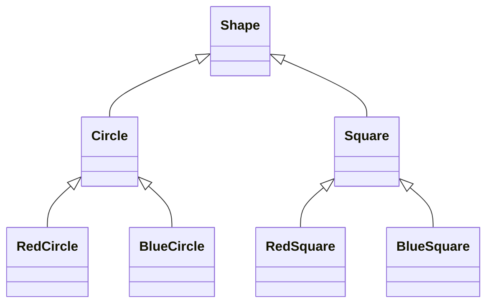

# Шаблони проєктування GoF
### Структурні шаблони, частина 2

---

## План

1. Bridge <!-- element class="fragment" -->
2. Composite <!-- element class="fragment" -->
3. Flyweight <!-- element class="fragment" -->
4. Порівняння структурних шаблонів <!-- element class="fragment" -->

---

## Минулого разу: обгортки

| Шаблон | Інтерфейс | Мета |
|---|---|---|
| Adapter | інший | сумісність |
| Decorator | той самий | нова поведінка |
| Facade | новий, простіший | спростити підсистему |
| Proxy | той самий | контроль доступу |

<!-- element class="fragment" -->
Сьогодні: як будувати **ієрархії** і **структури** об'єктів — дві незалежні осі змін, дерева, мільйони однакових об'єктів.

---

# Bridge
## Міст

![[gof_meme_bridge.png]] <!-- element style="height:340px" -->

---

## Проблема: фігури та кольори

Графічний редактор: класи `Circle` і `Square`.

- додали кольори: `RedCircle`, `BlueCircle`, `RedSquare`, `BlueSquare` <!-- element class="fragment" -->
- додали трикутник — ще два класи; зелений колір — ще три <!-- element class="fragment" -->

<!-- element class="fragment" -->

---

## Чому так стається

- ієрархія розширюється у **двох незалежних вимірах**: форма і колір <!-- element class="fragment" -->
- наслідування об'єднує їх в один → **N × M** класів <!-- element class="fragment" -->
- зміна логіки кольору — правки в усіх класах-комбінаціях <!-- element class="fragment" -->

<!-- element class="fragment" -->
Ідея: виділити один вимір в **окрему ієрархію** і з'єднати їх посиланням — "мостом".

---

## Рішення: Bridge

Структурний шаблон, який розділяє клас на дві окремі ієрархії — **абстракцію** та **реалізацію**, щоб змінювати їх незалежно.

![[gof_bridge.png]] <!-- element style="height:380px" -->

<small>Ілюстрації взято з https://refactoring.guru/uk/design-patterns/</small>

---

## Як це вирішує проблему

- `Shape` (абстракція) містить поле `Color color` (реалізація) <!-- element class="fragment" -->
- `Circle`, `Square` — розширюють абстракцію <!-- element class="fragment" -->
- `Red`, `Blue` — реалізують `Color` <!-- element class="fragment" -->
- будь-яку фігуру поєднують з будь-яким кольором під час виконання <!-- element class="fragment" -->

<!-- element class="fragment" -->
Класів стає **N + M** замість **N × M**.

---

## Як виглядає Bridge?

![[gof_bridge_uml.png]] <!-- element style="height:440px" -->

---

## "Абстракція" і "реалізація"

Не в сенсі `abstract class` та `implements`!

- **абстракція** — високорівневий керуючий шар, з яким працює клієнт <!-- element class="fragment" -->
- **реалізація** — низькорівнева платформа, якій абстракція делегує роботу <!-- element class="fragment" -->

<!-- element class="fragment" -->
Приклад: GUI (абстракція) і API операційної системи (реалізація). Пульт (абстракція) і пристрій — телевізор, радіо (реалізація).

![[gof_meme_bridge_job.png]] <!-- element style="height:200px" class="fragment" -->

---

## Bridge у Java

- **JDBC**: застосунок працює з API `java.sql` (абстракція), драйвери MySQL / PostgreSQL — реалізації <!-- element class="fragment" -->
- **SLF4J**: API логування окремо, Logback / Log4j2 — реалізації <!-- element class="fragment" -->
- **java.util.logging**: `Handler` (куди писати) і `Formatter` (як форматувати) — два незалежні виміри <!-- element class="fragment" -->
- **AWT**: компоненти (абстракція) і peer-класи конкретної ОС (реалізація) <!-- element class="fragment" -->

---

## Bridge vs Adapter vs Strategy

| | Bridge | Adapter | Strategy |
|---|---|---|---|
| Коли вводять | **заздалегідь**, при проєктуванні | **постфактум**, до несумісного коду | коли є варіанти алгоритму |
| Мета | дві незалежні ієрархії | сумісність | замінна поведінка |
| Структура | композиція | композиція | композиція |

<!-- element class="fragment" -->
Структурно схожі — різниця в **намірі**.

---

## ENOUGH THEORY

![[gof_enough_theory.png]] <!-- element style="height:460px" -->

---

## Переваги і недоліки Bridge

| Переваги | Недоліки |
|---|---|
| ієрархії розвиваються незалежно | ускладнює дизайн при одному вимірі змін |
| приховує деталі реалізації від клієнта | додаткові класи |
| реалізує OCP | |

---

# Composite
## Компонувальник

![[gof_meme_composite.jpg]] <!-- element style="height:420px" -->

---

## Проблема: ціна замовлення

Інтернет-магазин відправляє замовлення в коробках.

- коробка містить товари і **менші коробки** <!-- element class="fragment" -->
- ті коробки — ще товари і ще коробки <!-- element class="fragment" -->
- потрібно порахувати загальну ціну замовлення <!-- element class="fragment" -->

Прямолінійно: <!-- element class="fragment" -->
- розпакувати все, перевіряючи `instanceof Product` / `instanceof Box` <!-- element class="fragment" -->
- той самий обхід з `instanceof` — для ваги, для друку накладної, для перевірки заборонених товарів <!-- element class="fragment" -->

---

## Рішення: Composite

Структурний шаблон, що дає змогу згрупувати об'єкти в **деревоподібну структуру** і працювати з нею як з одиничним об'єктом.

![[gof_composite.png]] <!-- element style="height:380px" -->

<small>Ілюстрації взято з https://refactoring.guru/uk/design-patterns/</small>

---

## Як це вирішує проблему

- спільний інтерфейс `Item` з методом `price()` <!-- element class="fragment" -->
- `Product.price()` — повертає свою ціну (**лист**) <!-- element class="fragment" -->
- `Box.price()` — питає ціну в кожного вмісту і сумує (**контейнер**) <!-- element class="fragment" -->
- клієнт викликає `order.price()` і не знає, що там всередині <!-- element class="fragment" -->

<!-- element class="fragment" -->
Рекурсія схована в структурі, а не в клієнтському коді.

---

## Як виглядає Composite?

![[gof_composite_uml.png]] <!-- element style="height:440px" -->

---

## Де оголошувати `add()` / `remove()`?

| | Transparent (прозорий) | Safe (безпечний) |
|---|---|---|
| Методи керування дітьми | у спільному інтерфейсі `Component` | лише в `Composite` |
| Клієнт | не розрізняє лист і контейнер | має знати, з чим працює |
| Ризик | `leaf.add()` → `UnsupportedOperationException` | `instanceof` для додавання дітей |

<!-- element class="fragment" -->
GoF віддавали перевагу прозорості, сучасна практика частіше обирає безпечний варіант.

---

## Composite у Java

- **AWT/Swing**: `Container extends Component` — панель містить кнопки та інші панелі <!-- element class="fragment" -->
- **JavaFX**: `Parent` / `Node` — граф сцени <!-- element class="fragment" -->
- файлова система: каталог і файл <!-- element class="fragment" -->
- AST компілятора, меню, організаційна структура, правила валідації <!-- element class="fragment" -->

<!-- element class="fragment" -->
Сучасна Java: `sealed interface Item permits Product, Box` — компілятор знає всі варіанти вузлів.

---

## Пастки Composite

- **цикли**: коробка, вкладена сама в себе → нескінченна рекурсія, `StackOverflowError` <!-- element class="fragment" -->
- дуже глибокі дерева — рекурсивний обхід переповнює стек; допомагає ітеративний обхід зі стеком <!-- element class="fragment" -->
- дорогі операції на великих деревах — кешувати результат у контейнері <!-- element class="fragment" -->
- занадто загальний інтерфейс: важко обмежити, що саме може міститися в контейнері <!-- element class="fragment" -->

---

## ENOUGH THEORY

![[gof_enough_theory.png]] <!-- element style="height:460px" -->

---

## Переваги і недоліки Composite

| Переваги | Недоліки |
|---|---|
| спрощує клієнта при роботі зі складним деревом | занадто загальний інтерфейс компонента |
| легко додавати нові типи вузлів | важко обмежити вміст контейнерів |
| реалізує OCP | |

---

# Flyweight
## Легковаговик

![[gof_meme_flyweight.jpg]] <!-- element style="height:420px" -->

---

## Проблема: мільйон куль

Гра: кожна куля, осколок і частинка диму — об'єкт.

- кожна частинка зберігає спрайт (~20 КБ), колір, координати, вектор руху <!-- element class="fragment" -->
- у бою — 1 000 000 частинок <!-- element class="fragment" -->
- 1 000 000 × 20 КБ ≈ **20 ГБ** → `OutOfMemoryError` <!-- element class="fragment" -->

<!-- element class="fragment" -->
Але спрайтів лише три: куля, осколок, дим. Різняться тільки координати і швидкість.

---

## Рішення: Flyweight

Структурний шаблон, що дає змогу вмістити більше об'єктів у пам'яті, **розподіляючи спільний стан** між об'єктами замість зберігання однакових даних у кожному.

![[gof_flyweight.png]] <!-- element style="height:360px" -->

<small>Ілюстрації взято з https://refactoring.guru/uk/design-patterns/</small>

---

## Внутрішній і зовнішній стан

| | Внутрішній (intrinsic) | Зовнішній (extrinsic) |
|---|---|---|
| Приклад | спрайт, колір | координати, швидкість |
| Спільний | так | ні, унікальний |
| Змінюється | **ніколи** | постійно |
| Де живе | у легковаговику | у контексті або передається в метод |

<!-- element class="fragment" -->
3 спрайти × 20 КБ + 1 000 000 × ~40 байт ≈ **40 МБ** замість 20 ГБ.

---

## Як виглядає Flyweight?

![[gof_flyweight_uml.png]] <!-- element style="height:420px" -->

- **FlyweightFactory** кешує легковаговики і видає наявний замість створення нового <!-- element class="fragment" -->

---

## Flyweight у Java

- `Integer.valueOf()` кешує значення **від -128 до 127**; так само `Short`, `Byte`, `Long`, `Character`, `Boolean` <!-- element class="fragment" -->
- **String pool**: рядкові літерали інтерновані, `String.intern()` <!-- element class="fragment" -->
- G1 з `-XX:+UseStringDeduplication` — автоматично ділить однакові масиви символів рядків <!-- element class="fragment" -->
- константи `enum` <!-- element class="fragment" -->

---

## Пастка: ідентичність

`Integer a = 127, b = 127` → `a == b` дає `true`

`Integer a = 128, b = 128` → `a == b` дає `false` <!-- element class="fragment" -->

<!-- element class="fragment" -->
Перші — один закешований об'єкт, другі — два різні. Об'єкти-обгортки і рядки порівнюють **лише через `equals()`**.

<!-- element class="fragment" -->
Загальне правило: програма з легковаговиками не повинна залежати від ідентичності об'єктів.

---

## Вимоги до реалізації

- легковаговик **незмінний** — інакше зміна в одному місці змінить усі "копії" <!-- element class="fragment" -->
- фабрика потокобезпечна: `ConcurrentHashMap.computeIfAbsent()` <!-- element class="fragment" -->
- застосовувати лише після вимірювання: профайлер показав, що пам'ять з'їдають однакові дані <!-- element class="fragment" -->

---

## ENOUGH THEORY

![[gof_enough_theory.png]] <!-- element style="height:460px" -->

---

## Переваги і недоліки Flyweight

| Переваги | Недоліки |
|---|---|
| заощаджує оперативну пам'ять | витрачає процесорний час на пошук / обчислення контексту |
| | ускладнює код: стан розділено на дві частини |
| | ідентичність об'єктів втрачає сенс |

---

# Порівняння

---

## Структурні шаблони

| Шаблон | Проблема | Ключова ідея |
|---|---|---|
| Adapter | несумісний інтерфейс | перетворення інтерфейсу |
| Decorator | вибух комбінацій поведінки | вкладені обгортки |
| Facade | складна підсистема | простий вхід |
| Proxy | контроль доступу | замінник з тим самим інтерфейсом |
| Bridge | вибух N × M класів | дві ієрархії, з'єднані композицією |
| Composite | дерево об'єктів | лист і контейнер з одним інтерфейсом |
| Flyweight | мільйони однакових об'єктів | спільний незмінний стан |

---

## Висновки

- **Bridge** — розділяє дві незалежні осі змін на окремі ієрархії; JDBC і SLF4J побудовані саме так <!-- element class="fragment" -->
- **Composite** — дерево, з яким клієнт працює як з одним об'єктом; рекурсія схована в структурі <!-- element class="fragment" -->
- **Flyweight** — спільний незмінний стан; в Java — кеш `Integer` і String pool, тож порівнюйте через `equals()` <!-- element class="fragment" -->
- усі структурні шаблони спираються на **композицію замість наслідування** <!-- element class="fragment" -->

---

# Питання?

![[gof_meme_thanks.png]] <!-- element style="height:400px" -->
