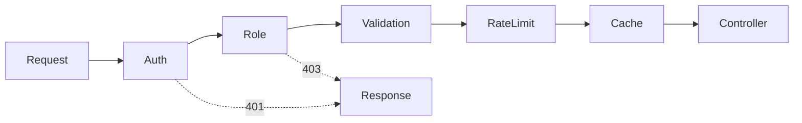

# Шаблони проєктування GoF
### Поведінкові шаблони, частина 1

---

## План

1. Що таке поведінкові шаблони <!-- element class="fragment" -->
2. Chain of Responsibility <!-- element class="fragment" -->
3. Command <!-- element class="fragment" -->
4. Порівняння <!-- element class="fragment" -->

---

## Поведінкові шаблони

Породжувальні — **як створити**, структурні — **як поєднати**.

Поведінкові — **як об'єкти взаємодіють і розподіляють обов'язки**: <!-- element class="fragment" -->
- хто обробляє запит <!-- element class="fragment" -->
- як передати дію як об'єкт <!-- element class="fragment" -->
- як сповістити про подію <!-- element class="fragment" -->
- як змінити алгоритм або поведінку під час виконання <!-- element class="fragment" -->

---

## Поведінкові шаблони: маршрут

| Лекція | Шаблони | Спільна тема |
|---|---|---|
| 20 | Chain of Responsibility, Command | запит як об'єкт, що мандрує системою |
| 21 | Observer, Mediator | комунікація між багатьма об'єктами |
| 22 | Strategy, State, Template Method | змінна поведінка |
| 23 | Memento, Visitor, Iterator | стан, операції, обхід |

---

# Chain of Responsibility
## Ланцюжок обов'язків

![[gof_meme_chain.jpg]] <!-- element style="height:420px" -->

---

## Проблема: обробка запиту до API

Метод `OrderController.create(request)` перед бізнес-логікою:

1. перевіряє токен — автентифікація <!-- element class="fragment" -->
2. перевіряє роль — авторизація <!-- element class="fragment" -->
3. валідує і очищає дані <!-- element class="fragment" -->
4. блокує IP після 10 невдалих спроб — захист від brute force <!-- element class="fragment" -->
5. повертає відповідь з кешу, якщо такий запит вже був <!-- element class="fragment" -->

<!-- element class="fragment" -->
Кожна перевірка — ще один `if` в тому самому методі. Іншим контролерам потрібна частина перевірок, в іншому порядку — код копіюється.

---

## Рішення: Chain of Responsibility

Поведінковий шаблон, що дає змогу передавати запити **послідовно ланцюжком обробників**. Кожен обробник вирішує, чи обробити запит самому і чи передавати його далі.

![[gof_chain.png]] <!-- element style="height:340px" -->

<small>Ілюстрації взято з https://refactoring.guru/uk/design-patterns/</small>

---

## Як це вирішує проблему

- кожна перевірка — окремий клас-обробник з посиланням на наступного <!-- element class="fragment" -->
- обробник може **зупинити** ланцюжок (немає токена → 401) або **передати далі** <!-- element class="fragment" -->
- ланцюжок збирають з потрібних обробників у потрібному порядку <!-- element class="fragment" -->

---

## Як виглядає Chain of Responsibility?

![[gof_chain_uml.png]] <!-- element style="height:440px" -->

---

## Два варіанти ланцюжка

| | Класичний GoF | Pipeline (фільтри) |
|---|---|---|
| Хто обробляє | **перший**, хто може | **кожен** обробник по черзі |
| Далі | зупиняється на обробнику | передає далі, якщо не відхилив |
| Приклад | обробка винятків, служба підтримки | Servlet Filters, middleware |

<!-- element class="fragment" -->
Приклад класичного: дзвінок у підтримку — автовідповідач → оператор → інженер. Хто зміг допомогти — на тому й зупиняємось.

---

## Chain of Responsibility у Java

- **Servlet API**: `Filter` + `FilterChain.doFilter()` <!-- element class="fragment" -->
- **Spring Security**: `SecurityFilterChain` — десятки фільтрів у визначеному порядку <!-- element class="fragment" -->
- **Spring MVC**: `HandlerInterceptor` — `preHandle()` повертає `false` і зупиняє ланцюжок <!-- element class="fragment" -->
- **java.util.logging**: запис передається батьківським логерам <!-- element class="fragment" -->
- обробка винятків: виняток піднімається стеком викликів до першого відповідного `catch` <!-- element class="fragment" -->

---

## Пастки

- **запит ніхто не обробив** — потрібен обробник за замовчуванням у кінці <!-- element class="fragment" -->
- **порядок критичний**: кеш перед авторизацією віддасть чужі дані <!-- element class="fragment" -->
- обробник забув викликати наступного — ланцюжок мовчки обірвався <!-- element class="fragment" -->
- довгий ланцюжок важко відлагоджувати: де саме зупинився запит? <!-- element class="fragment" -->

<!-- element class="fragment" -->
Порядок у Spring задають через `@Order` або явну конфігурацію ланцюжка.

---

## ENOUGH THEORY

![[gof_enough_theory.png]] <!-- element style="height:460px" -->

---

## Переваги і недоліки Chain of Responsibility

| Переваги | Недоліки |
|---|---|
| зменшує залежність між клієнтом і обробниками | запит може залишитися необробленим |
| реалізує SRP: одна перевірка — один клас | важко відлагоджувати довгі ланцюжки |
| реалізує OCP: новий обробник без зміни інших | порядок обробників критичний |

---

# Command
## Команда

![[gof_meme_command.jpg]] <!-- element style="height:420px" -->

---

## Проблема: текстовий редактор

Редактор має панель інструментів, меню і гарячі клавіші.

- кнопка "Копіювати", пункт меню "Копіювати" і `Ctrl+C` роблять одне й те саме <!-- element class="fragment" -->
- підкласи `CopyButton`, `PasteButton`, `SaveButton`… — десятки класів, логіка в UI <!-- element class="fragment" -->
- код копіювання дублюється в кнопці, меню і обробнику клавіш <!-- element class="fragment" -->
- потрібно **скасування** (`Ctrl+Z`) — а кнопка не пам'ятає, що зробила <!-- element class="fragment" -->

---

## Ще проблеми

- операцію потрібно виконати **пізніше** або в іншому потоці <!-- element class="fragment" -->
- операції треба ставити в **чергу** <!-- element class="fragment" -->
- після збою — **повторити** журнал операцій <!-- element class="fragment" -->
- кілька операцій об'єднати в одну — **макрос** <!-- element class="fragment" -->

<!-- element class="fragment" -->
Виклик методу — це мить. Щоб його зберігати, передавати і скасовувати, він має стати **об'єктом**.

---

## Рішення: Command

Поведінковий шаблон, який **перетворює запит на об'єкт**: його можна передати як аргумент, поставити в чергу, залогувати, скасувати.

![[gof_command.png]] <!-- element style="height:340px" -->

<small>Ілюстрації взято з https://refactoring.guru/uk/design-patterns/</small>

---

## Як це вирішує проблему

- `CopyCommand`, `PasteCommand` реалізують інтерфейс `Command` з методом `execute()` <!-- element class="fragment" -->
- кнопка, меню і гаряча клавіша отримують **той самий** об'єкт команди <!-- element class="fragment" -->
- UI не знає, що робить команда; команда викликає редактор <!-- element class="fragment" -->
- виконані команди кладемо в стек історії — `undo()` знімає останню <!-- element class="fragment" -->

---

## Як виглядає Command?

![[gof_command_uml.png]] <!-- element style="height:420px" -->

---

## Ролі

| Роль | Хто | Що робить |
|---|---|---|
| **Invoker** | кнопка, меню, планувальник | запускає команду, не знаючи деталей |
| **Command** | `PasteCommand` | зберігає параметри і отримувача |
| **Receiver** | редактор | виконує реальну роботу |
| **Client** | конфігурація застосунку | створює команди і передає їх ініціаторам |

---

## Undo: два підходи

| | Зворотна операція | Знімок стану |
|---|---|---|
| Як | `undo()` робить протилежне до `execute()` | перед `execute()` зберегти стан, `undo()` відновлює |
| Пам'ять | мало | більше |
| Складність | зворотна операція не завжди існує | просто |
| Шаблон | Command | Command + **Memento** (лекція 23) |

---

## Command у Java

- `Runnable`, `Callable` — команди, які `ExecutorService` ставить у чергу і виконує в пулі потоків <!-- element class="fragment" -->
- `ScheduledExecutorService` — відкладене і періодичне виконання <!-- element class="fragment" -->
- **лямбди** та посилання на методи — найлегші команди без окремих класів <!-- element class="fragment" -->
- `javax.swing.Action` — команда для кнопки, пункту меню і гарячої клавіші одночасно <!-- element class="fragment" -->
- `javax.swing.undo.UndoManager` / `UndoableEdit` — готова історія undo/redo <!-- element class="fragment" -->

---

## Лямбда чи клас?

| Потрібно | Рішення |
|---|---|
| лише `execute()` | лямбда, `Runnable` |
| результат | `Callable<T>`, `Supplier<T>` |
| `undo()`, стан, параметри | окремий клас команди |
| серіалізація, журнал | клас-команда або `record` з даними |

<!-- element class="fragment" -->
На рівні архітектури та сама ідея — **CQRS** (команди окремо від запитів) і **Event Sourcing** (журнал змін як джерело правди).

---

## Макрокоманда

- `MacroCommand` містить список команд і виконує їх по черзі <!-- element class="fragment" -->
- `undo()` — скасовує у **зворотному** порядку <!-- element class="fragment" -->
- сама є командою — тобто це **Composite** з команд <!-- element class="fragment" -->

<!-- element class="fragment" -->
Приклад: "Форматувати документ" = змінити шрифт + вирівняти + пронумерувати заголовки, одним `Ctrl+Z`.

---

## ENOUGH THEORY

![[gof_enough_theory.png]] <!-- element style="height:460px" -->

---

## Переваги і недоліки Command

| Переваги | Недоліки |
|---|---|
| прибирає залежність між ініціатором і виконавцем | багато додаткових класів |
| просте скасування і повтор | |
| відкладений запуск, черги | |
| складні команди з простих; реалізує OCP | |

---

# Порівняння

---

## Chain of Responsibility vs Command

| | Chain of Responsibility | Command |
|---|---|---|
| Запит | передається **від обробника до обробника** | загорнутий в **об'єкт** |
| Хто виконує | заздалегідь невідомо | відомо: команда знає отримувача |
| Що дає | гнучкий порядок обробки | черги, відкладений запуск, undo |

<!-- element class="fragment" -->
Часто поєднуються: команди проходять ланцюжком обробників (валідація, логування, транзакція) — так працюють command bus-и.

---

## Висновки

- **Chain of Responsibility** — кожна перевірка в окремому обробнику, ланцюжок збирається з конфігурації; Servlet Filters і Spring Security — щоденні приклади <!-- element class="fragment" -->
- стежити за **порядком** обробників і обробником за замовчуванням <!-- element class="fragment" -->
- **Command** — дія як об'єкт: черги, відкладений запуск, undo, макроси <!-- element class="fragment" -->
- у Java прості команди — лямбди і `Runnable`; клас — коли потрібні стан і скасування <!-- element class="fragment" -->

---

# Питання?

![[gof_meme_thanks.png]] <!-- element style="height:400px" -->
