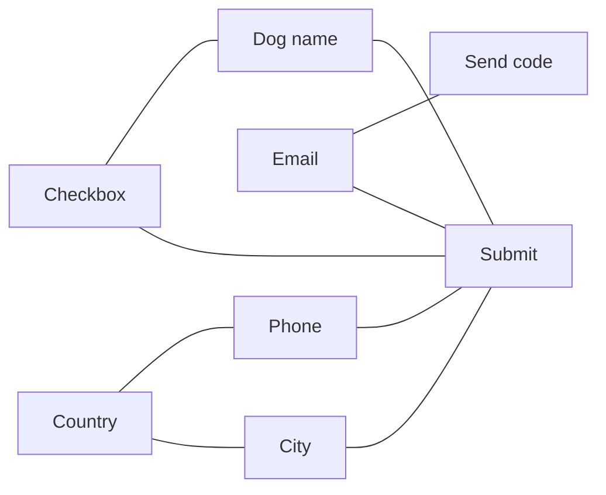

# Шаблони проєктування GoF
### Поведінкові шаблони, частина 2

---

## План

1. Observer <!-- element class="fragment" -->
2. Mediator <!-- element class="fragment" -->
3. Observer vs Mediator vs Facade <!-- element class="fragment" -->

---

## Минулого разу

| Шаблон | Ключова ідея |
|---|---|
| Chain of Responsibility | запит проходить ланцюжком обробників |
| Command | дія як об'єкт: черги, undo, макроси |

<!-- element class="fragment" -->
Сьогодні: як організувати комунікацію, коли об'єктів **багато** і всі мають знати про зміни один в одного.

---

# Observer
## Спостерігач

![[gof_meme_observer.png]] <!-- element style="height:420px" -->

---

## Проблема: нове замовлення

`OrderService.placeOrder()` після збереження замовлення:

- надсилає лист покупцю — `MailService` <!-- element class="fragment" -->
- оновлює аналітику — `AnalyticsService` <!-- element class="fragment" -->
- резервує товар — `WarehouseService` <!-- element class="fragment" -->
- нараховує бонуси — `LoyaltyService` <!-- element class="fragment" -->

<!-- element class="fragment" -->
Кожна нова реакція на замовлення — правка `OrderService` і ще одна залежність у конструкторі. Сервіс замовлень знає про всіх, хто цікавиться замовленнями.

---

## Інша сторона проблеми

Покупець чекає на новий телефон у магазині.

- **ходити в магазин щодня** (polling) — марні візити, затримка, навантаження <!-- element class="fragment" -->
- **магазин розсилає всім усе** — спам тим, кому це нецікаво <!-- element class="fragment" -->

<!-- element class="fragment" -->
Потрібно: ті, кому цікаво, **підписуються**; видавець сповіщає лише їх і не знає, хто вони.

---

## Рішення: Observer

Поведінковий шаблон, який створює **механізм підписки**: одні об'єкти стежать і реагують на події в інших.

![[gof_observer.png]] <!-- element style="height:340px" -->

<small>Ілюстрації взято з https://refactoring.guru/uk/design-patterns/</small>

---

## Як це вирішує проблему

- `OrderService` (видавець) тримає список підписників з інтерфейсом `OrderListener` <!-- element class="fragment" -->
- `subscribe()` / `unsubscribe()` — під час виконання <!-- element class="fragment" -->
- після збереження замовлення — `listener.onOrderPlaced(order)` для кожного <!-- element class="fragment" -->
- нова реакція — новий підписник; `OrderService` не змінюється <!-- element class="fragment" -->

---

## Як виглядає Observer?

![[gof_observer_uml.png]] <!-- element style="height:400px" -->

---

## Push vs Pull

| | Push | Pull |
|---|---|---|
| Що передає видавець | усі дані події | лише сигнал "щось змінилось" (або посилання на себе) |
| Підписник | отримує готове | сам запитує потрібне |
| Ризик | передаємо зайве | зайві звернення до видавця |

<!-- element class="fragment" -->
Найчастіше — push з об'єктом події: `record OrderPlaced(long orderId, BigDecimal total)`.

---

## Observer у Java

`java.util.Observer` / `Observable` — **deprecated з Java 9**:
- `Observable` — клас, а не інтерфейс: змушує наслідуватися <!-- element class="fragment" -->
- не потокобезпечний, бідна модель подій: `update(Observable o, Object arg)` <!-- element class="fragment" -->

---

## Сучасні альтернативи

- `java.beans.PropertyChangeSupport` / `PropertyChangeListener` <!-- element class="fragment" -->
- listener-и в Swing (`ActionListener`) і JavaFX (`ObservableValue`, `ChangeListener`) <!-- element class="fragment" -->
- **Spring**: `ApplicationEventPublisher` + `@EventListener` <!-- element class="fragment" -->
- `java.util.concurrent.Flow` (Java 9) — reactive streams з **backpressure**: підписник сам каже, скільки подій готовий прийняти <!-- element class="fragment" -->
- Project Reactor, RxJava — потоки подій з операторами <!-- element class="fragment" -->

---

## Spring events: нюанси

- `@EventListener` за замовчуванням **синхронний** — виконується в тому ж потоці і тій самій транзакції <!-- element class="fragment" -->
- виняток у підписнику відкотить транзакцію видавця <!-- element class="fragment" -->
- `@Async` — виконати в іншому потоці <!-- element class="fragment" -->
- `@TransactionalEventListener` — виконати **після коміту**: лист не піде, якщо замовлення не збереглося <!-- element class="fragment" -->

---

## Пастки Observer

- **lapsed listener** — забули відписатися → витік пам'яті: видавець тримає посилання на підписника <!-- element class="fragment" -->
- підписка / відписка під час розсилки → `ConcurrentModificationException`. Рішення: `CopyOnWriteArrayList` <!-- element class="fragment" -->
- виняток в одному підписнику зупиняє розсилку іншим <!-- element class="fragment" -->
- порядок сповіщення не гарантований — не будувати логіку на ньому <!-- element class="fragment" -->
- каскади: подія викликає подію, що викликає подію… — важко відлагоджувати <!-- element class="fragment" -->

---

## ENOUGH THEORY

![[gof_enough_theory.png]] <!-- element style="height:460px" -->

---

## Переваги і недоліки Observer

| Переваги | Недоліки |
|---|---|
| видавці не залежать від конкретних підписників | порядок сповіщення не гарантований |
| підписка / відписка "на льоту" | ризик витоків пам'яті |
| реалізує OCP | неявний потік виконання |

---

# Mediator
## Посередник

![[gof_meme_mediator.jpg]] <!-- element style="height:420px" -->

---

## Проблема: форма реєстрації

Діалог реєстрації: поля, чекбокси, кнопки.

- чекбокс "У мене є собака" показує поле "Кличка собаки" <!-- element class="fragment" -->
- поле email при зміні вмикає кнопку "Надіслати код" <!-- element class="fragment" -->
- кнопка "Зареєструватися" валідує всі поля і блокує себе на час запиту <!-- element class="fragment" -->
- вибір країни змінює формат телефону і список міст <!-- element class="fragment" -->

<!-- element class="fragment" -->
Кожен елемент знає про кількох інших. Чекбокс неможливо використати в іншій формі — він "знає" про поле собаки.

---

## Зв'язки "кожен з кожним"

- N компонентів → до N × (N − 1) / 2 зв'язків <!-- element class="fragment" -->
- зміна одного компонента зачіпає всіх сусідів <!-- element class="fragment" -->

---

## Рішення: Mediator

Поведінковий шаблон, що дає змогу зменшити зв'язаність великої кількості класів, **переносячи їхні зв'язки в один клас-посередник**.

![[gof_mediator.png]] <!-- element style="height:340px" -->

<small>Ілюстрації взято з https://refactoring.guru/uk/design-patterns/</small>

---

## Як це вирішує проблему

- компоненти знають лише посередника: `mediator.notify(this, "changed")` <!-- element class="fragment" -->
- `RegistrationDialog` (посередник) вирішує, що робити: показати поле, увімкнути кнопку <!-- element class="fragment" -->
- компоненти не знають один про одного → їх можна використати в інших формах <!-- element class="fragment" -->
- вся логіка взаємодії — в одному місці <!-- element class="fragment" -->

<!-- element class="fragment" -->
Аналогія: літаки не домовляються між собою — вони спілкуються з диспетчерською вежею.

---

## Як виглядає Mediator?

![[gof_mediator_uml.png]] <!-- element style="height:440px" -->

---

## Mediator у Java

- контролер форми в JavaFX / Swing координує елементи керування <!-- element class="fragment" -->
- Spring MVC `DispatcherServlet` — координує контролери, view resolver-и, обробники винятків <!-- element class="fragment" -->
- шина подій: Spring `ApplicationEventPublisher`, Guava `EventBus` <!-- element class="fragment" -->
- на рівні архітектури — брокер повідомлень (Kafka, RabbitMQ): сервіси не викликають один одного напряму <!-- element class="fragment" -->

---

## Пастка: God Object

- посередник збирає **всю** логіку взаємодії → розростається до тисяч рядків <!-- element class="fragment" -->
- складність не зникає — вона переїжджає в одне місце <!-- element class="fragment" -->

Що робити: <!-- element class="fragment" -->
- кілька посередників за сценаріями <!-- element class="fragment" -->
- бізнес-правила — в доменні класи, посереднику лишити координацію <!-- element class="fragment" -->

---

## ENOUGH THEORY

![[gof_enough_theory.png]] <!-- element style="height:460px" -->

---

## Переваги і недоліки Mediator

| Переваги | Недоліки |
|---|---|
| усуває залежності між компонентами | посередник може "роздутися" до God Object |
| компоненти можна використати повторно | |
| керування взаємодією в одному місці | |

---

# Порівняння

---

## Observer vs Mediator vs Facade

| | Observer | Mediator | Facade |
|---|---|---|---|
| Напрям зв'язку | один → багато | багато ↔ посередник ↔ багато | клієнт → підсистема |
| Хто про кого знає | видавець не знає підписників | компоненти знають лише посередника | підсистема не знає про фасад |
| Мета | розсилка подій | прибрати хаотичні зв'язки | спростити доступ |

<!-- element class="fragment" -->
Посередника часто реалізують **через Observer**: компоненти публікують події, посередник на них підписаний.

---

## Висновки

- **Observer** — видавець не знає підписників; нова реакція не змінює видавця <!-- element class="fragment" -->
- у Java: `Observable` deprecated → listener-и, Spring events, `Flow`, Reactor <!-- element class="fragment" -->
- стежити за відпискою, винятками в підписниках і транзакціями <!-- element class="fragment" -->
- **Mediator** — зв'язки "кожен з кожним" замінює зв'язками через центр; ризик — God Object <!-- element class="fragment" -->

---

# Питання?

![[gof_meme_thanks.png]] <!-- element style="height:400px" -->
