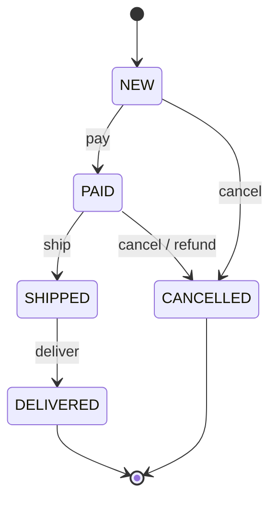

# Шаблони проєктування GoF
### Поведінкові шаблони, частина 3

---

## План

1. Strategy <!-- element class="fragment" -->
2. State <!-- element class="fragment" -->
3. Template Method <!-- element class="fragment" -->
4. Strategy vs State vs Template Method <!-- element class="fragment" -->

---

## Минулого разу

| Шаблон | Ключова ідея |
|---|---|
| Observer | підписка на події, видавець не знає підписників |
| Mediator | зв'язки між компонентами — через центр |

<!-- element class="fragment" -->
Сьогодні: три способи організувати **змінну поведінку** — замість `if` і `switch`, що ростуть з кожною вимогою.

---

# Strategy
## Стратегія

![[gof_meme_strategy.jpg]] <!-- element style="height:420px" -->

---

## Проблема: вартість доставки

Пам'ятаєте приклад з GRASP? `Checkout.deliveryCost(order)`:

- самовивіз — 0 <!-- element class="fragment" -->
- кур'єр — 80 грн, безкоштовно від 1000 грн <!-- element class="fragment" -->
- поштомат — залежить від ваги <!-- element class="fragment" -->
- міжнародна — від країни, ваги та курсу валют <!-- element class="fragment" -->

<!-- element class="fragment" -->
Все в одному `switch (deliveryType)`. Новий спосіб щокварталу — правка `Checkout`, який ще й оформлює замовлення. Тести одного способу змушують налаштовувати всі.

---

## Рішення: Strategy

Поведінковий шаблон, який визначає **сімейство схожих алгоритмів** і розміщує кожен у власному класі. Алгоритми можна заміняти прямо під час виконання.

![[gof_strategy.png]] <!-- element style="height:340px" -->

<small>Ілюстрації взято з https://refactoring.guru/uk/design-patterns/</small>

---

## Як це вирішує проблему

- інтерфейс `DeliveryStrategy` з методом `cost(Order)` <!-- element class="fragment" -->
- `PickupDelivery`, `CourierDelivery`, `LockerDelivery`, `InternationalDelivery` <!-- element class="fragment" -->
- `Checkout` (контекст) тримає посилання на стратегію і делегує їй розрахунок <!-- element class="fragment" -->
- новий спосіб — новий клас; `Checkout` не змінюється (**OCP**) <!-- element class="fragment" -->

<!-- element class="fragment" -->
Це GoF-реалізація GRASP **Polymorphism** і **Protected Variations**.

---

## Як виглядає Strategy?

![[gof_strategy_uml.png]] <!-- element style="height:420px" -->

- стратегію обирає **клієнт** і передає в контекст <!-- element class="fragment" -->

---

## Strategy у Java

- **`Comparator<T>`** — класична стратегія порівняння для `sort()`, `TreeMap`, стрімів <!-- element class="fragment" -->
- функціональні інтерфейси (`Function`, `Predicate`, `Supplier`) + **лямбди** — стратегія без ієрархії класів <!-- element class="fragment" -->
- `enum` зі своєю реалізацією методу в кожній константі <!-- element class="fragment" -->
- `ThreadPoolExecutor` + `RejectedExecutionHandler` — що робити, коли черга переповнена <!-- element class="fragment" -->

---

## Як обрати стратегію без `switch`

`switch` повернувся — тепер у виборі стратегії?

- `Map<DeliveryType, DeliveryStrategy>` — вибір за ключем <!-- element class="fragment" -->
- **Spring**: впровадження `Map<String, DeliveryStrategy>` або `List<DeliveryStrategy>` — контейнер сам збирає всі біни-стратегії <!-- element class="fragment" -->
- новий спосіб доставки — новий `@Component`, більше нічого <!-- element class="fragment" -->

---

## Лямбда чи клас?

| Стратегія | Рішення |
|---|---|
| одна формула, без стану | лямбда |
| фіксований набір варіантів | `enum` |
| залежності (курси валют, тарифи з БД) | окремий клас, Spring-бін |
| складна, з тестами | окремий клас |

---

## ENOUGH THEORY

![[gof_enough_theory.png]] <!-- element style="height:460px" -->

---

## Переваги і недоліки Strategy

| Переваги | Недоліки |
|---|---|
| заміна алгоритмів "на льоту" | додаткові класи (у Java часто — лише лямбди) |
| ізолює код і дані алгоритмів | клієнт має знати різницю між стратегіями |
| делегування замість наслідування | надмірна, якщо алгоритм один і не зміниться |
| реалізує OCP | |

---

# State
## Стан

![[gof_meme_state.jpg]] <!-- element style="height:420px" -->

---

## Проблема: життєвий цикл замовлення

---

## Проблема: `switch` у кожному методі

- `pay()` — дозволено лише для `NEW` <!-- element class="fragment" -->
- `cancel()` — для `NEW` просто скасувати, для `PAID` — ще й повернути гроші, для `SHIPPED` — заборонено <!-- element class="fragment" -->
- `ship()`, `deliver()` — кожен зі своїм `switch (status)` <!-- element class="fragment" -->

<!-- element class="fragment" -->
Новий стан "Повернення" — правка **кожного** методу. Правила одного стану розкидані по всьому класу.

---

## Рішення: State

Поведінковий шаблон, що дає змогу об'єктам **змінювати поведінку залежно від стану**. Ззовні здається, ніби змінився клас об'єкта.

![[gof_state.png]] <!-- element style="height:340px" -->

<small>Ілюстрації взято з https://refactoring.guru/uk/design-patterns/</small>

---

## Скінченний автомат

![[gof_state_graph.png]] <!-- element style="height:300px" -->

- скінченна кількість станів <!-- element class="fragment" -->
- у кожному стані — своя поведінка <!-- element class="fragment" -->
- переходи між станами визначені правилами <!-- element class="fragment" -->

---

## Як це вирішує проблему

- інтерфейс `OrderState` з методами `pay()`, `cancel()`, `ship()`, `deliver()` <!-- element class="fragment" -->
- `NewState`, `PaidState`, `ShippedState`… — кожен клас знає правила **свого** стану <!-- element class="fragment" -->
- `Order` (контекст) делегує виклики поточному стану <!-- element class="fragment" -->
- стан сам переводить контекст у наступний: `PaidState.ship()` → `order.setState(new ShippedState())` <!-- element class="fragment" -->

---

## Як виглядає State?

![[gof_state_uml.png]] <!-- element style="height:420px" -->

---

## Хто вирішує про переходи?

| | Стани | Контекст |
|---|---|---|
| Як | стан сам встановлює наступний | контекст має таблицю переходів |
| Плюс | логіка стану повністю в одному класі | усі переходи видно в одному місці |
| Мінус | стани знають один про одного | контекст росте |

---

## State у Java

- **`enum`** з абстрактними методами — кожна константа реалізує поведінку свого стану <!-- element class="fragment" -->
- **`sealed interface` + `record`** (Java 17+) і `switch` з pattern matching (Java 21) — компілятор перевіряє, що оброблено **всі** стани <!-- element class="fragment" -->
- **Spring Statemachine** — для складних автоматів з подіями, guard-умовами і збереженням стану <!-- element class="fragment" -->

<!-- element class="fragment" -->
Стан у БД зберігаємо як `enum`-колонку; об'єкт стану відновлюємо при завантаженні.

---

## ENOUGH THEORY

![[gof_enough_theory.png]] <!-- element style="height:460px" -->

---

## Переваги і недоліки State

| Переваги | Недоліки |
|---|---|
| позбавляє від великих умовних операторів | надмірний, якщо станів мало і вони рідко змінюються |
| код стану — в одному місці | стани можуть знати один про одного |
| спрощує код контексту | |

---

# Template Method
## Шаблонний метод

![[gof_meme_template.jpg]] <!-- element style="height:420px" -->

---

## Проблема: імпорт даних

Сервіс імпортує товари від постачальників у форматах CSV, JSON і XML.

Кожен імпортер: <!-- element class="fragment" -->
1. відкриває файл <!-- element class="fragment" -->
2. **розбирає** формат <!-- element class="fragment" -->
3. валідує товари <!-- element class="fragment" -->
4. зберігає в БД <!-- element class="fragment" -->
5. надсилає звіт <!-- element class="fragment" -->

<!-- element class="fragment" -->
Три класи майже однакові — різниться лише крок 2. Виправили баг у валідації CSV — забули про JSON і XML.

---

## Рішення: Template Method

Поведінковий шаблон, який визначає **кістяк алгоритму**, перекладаючи відповідальність за деякі кроки на підкласи. Підкласи перевизначають кроки, не змінюючи загальної структури.

![[gof_template_method.png]] <!-- element style="height:320px" -->

<small>Ілюстрації взято з https://refactoring.guru/uk/design-patterns/</small>

---

## Як це вирішує проблему

- абстрактний `DataImporter` з методом `importFile()` — викликає кроки в правильному порядку <!-- element class="fragment" -->
- спільні кроки (відкрити, валідувати, зберегти, звіт) реалізовані в базовому класі <!-- element class="fragment" -->
- `parse()` — абстрактний, його реалізують `CsvImporter`, `JsonImporter`, `XmlImporter` <!-- element class="fragment" -->
- `importFile()` позначений **`final`** — підклас не зламає порядок кроків <!-- element class="fragment" -->

---

## Як виглядає Template Method?

![[gof_template_method_uml.png]] <!-- element style="height:420px" -->

---

## Типи кроків

| Крок | Реалізація | Підклас |
|---|---|---|
| **абстрактний** | немає | **мусить** перевизначити |
| **за замовчуванням** | є | **може** перевизначити |
| **hook** | порожній | може "вклинитись" (напр. `beforeSave()`) |
| **шаблонний метод** | `final` | не може змінити |

<!-- element class="fragment" -->
**Голлівудський принцип**: "Не дзвоніть нам — ми вам подзвонимо". Базовий клас викликає підклас, а не навпаки.

---

## Template Method у Java

- `AbstractList` — реалізуйте `get()` і `size()`, решту дає базовий клас <!-- element class="fragment" -->
- `HttpServlet.service()` викликає `doGet()`, `doPost()`… <!-- element class="fragment" -->
- `InputStream.read(byte[])` побудований на абстрактному `read()` <!-- element class="fragment" -->
- JUnit: `@BeforeEach` / `@AfterEach` — hooks навколо тесту <!-- element class="fragment" -->

---

## Сучасна альтернатива: callback-и

Spring `JdbcTemplate`, `TransactionTemplate`, `RestTemplate`:
- шаблон (відкрити з'єднання, транзакція, обробка винятків) — в класі-шаблоні <!-- element class="fragment" -->
- змінний крок передається **лямбдою**, а не підкласом <!-- element class="fragment" -->

<!-- element class="fragment" -->
Композиція замість наслідування: без ієрархії класів, кроки комбінуються вільно.

---

## ENOUGH THEORY

![[gof_enough_theory.png]] <!-- element style="height:460px" -->

---

## Переваги і недоліки Template Method

| Переваги | Недоліки |
|---|---|
| повторне використання спільного коду | жорстко обмежені скелетом алгоритму |
| зміни спільних кроків — в одному місці | зі зростанням кількості кроків важко підтримувати |
| | наслідування — найсильніший зв'язок; може порушити LSP |

---

# Порівняння

---

## Strategy vs State

| | Strategy | State |
|---|---|---|
| Хто обирає | **клієнт** | **сам об'єкт** / стани переходять один в одного |
| Варіанти знають один про одного | ні | так, стан знає наступний |
| Мета | замінний алгоритм | поведінка залежить від життєвого циклу |

<!-- element class="fragment" -->
Структура однакова — делегування об'єкту-поведінці. Різниця — в намірі.

---

## Strategy vs Template Method

| | Strategy | Template Method |
|---|---|---|
| Механізм | композиція | наслідування |
| Що змінюється | весь алгоритм | окремі кроки |
| Коли обирається | під час виконання | під час компіляції |
| Рівень | об'єкт | клас |

---

## Висновки

- **Strategy** — сімейство взаємозамінних алгоритмів; у Java — `Comparator`, лямбди, Spring-біни в `Map` <!-- element class="fragment" -->
- **State** — поведінка залежить від стану, кожен стан в окремому класі; у Java — `enum` або `sealed` + `switch` <!-- element class="fragment" -->
- **Template Method** — кістяк алгоритму в базовому класі, кроки в підкласах; сучасна альтернатива — callback-и <!-- element class="fragment" -->
- усі три замінюють `switch`, що росте з кожною вимогою <!-- element class="fragment" -->

---

# Питання?

![[gof_meme_thanks.png]] <!-- element style="height:400px" -->
